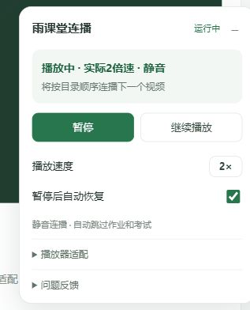

# 雨课堂视频连播 · 1.3.5

自动播放、2倍速、静音、暂停恢复，按目录跳过作业和考试，只连播视频。调试记录自动开启。

## 安装或更新

1. 安装并启用 Tampermonkey（油猴）。
2. 将 `yuketang-autoplay.user.js` 全部代码粘贴进油猴脚本并保存。更新时覆盖原脚本，原有控件标记会保留，不需要另建一份。
3. Chrome 中进入 `chrome://extensions/?id=dhdgffkkebhmkfjojejmpbldmpobfkfo`，确认允许油猴访问雨课堂，并开启“允许用户脚本”。缺少该选项时，参考 [Tampermonkey 官方说明](https://www.tampermonkey.net/faq.php?locale=zh&q=Q209)检查扩展管理页的开发者模式。
4. 刷新课程视频页，等待视频数据就绪后至少4秒。浏览器拒绝自动播放时，点“继续播放”。

## 面板

主面板显示实际倍速和声音状态，保留“暂停／开始”“继续播放”、速度切换和自动恢复开关。右上角可收起面板，不影响后台脚本运行。

1.3.5 增加明确反馈：控件标记保存后提示“控件已记住”；初始化后实际倍速和静音连续验证通过，才提示“设置成功”。成功提示显示8秒，状态区持续保留验证结果；设置被页面重置时会撤销成功状态并提示重新应用。保存标记与实际生效分开判断。

“播放器适配”和“问题反馈”默认折叠，正常使用无需展开。主动暂停请点“暂停”，或关闭“暂停后自动恢复”；原生视频暂停事件无法可靠区分手动暂停和页面程序暂停。



## 连播、作业和考试

视频自然结束后等待15秒，让网站自身处理进度保存。优先根据左侧目录的资源类型和当前条目，直接点击之后的第一个视频，跨过中间的作业、考试。最后一个视频之后只有作业和考试时停止。

若网站先进入作业或考试页，脚本等待页面加载后再查找下一个视频。目录暂时无法识别时，使用同一个“下一节”组件逐项前进；每个页面只自动点击一次。视频页仅仅加载慢，不会因此被当作作业跳过。

目录识别利用侧栏、资源标签、链接、当前选中状态或资源ID。已自动找到当前项时，适配区显示“目录已识别”，无需再次标记。识别不到当前条目时，可在“播放器适配 → 识别当前目录项”中点击左侧当前视频的标题、图标或条目外框；点击整个章节区域不会随意选择某一项，识别失败会自动退出设置并恢复轮询。

1.3.1 收紧了目录区域判断，防止主视频标题的 `header-left` 等样式被误认为侧栏资源。目录里锁定的视频会等待解锁，未挂载的折叠章节可能需要先手动展开。脚本只跳过导航，不提交作业或考试，也不修改它们的完成状态。

## 播放器适配

已有标记在更新后会保留，先直接试用新版。仅在相应控制仍失败时重新设置：

控件记忆保存在油猴的脚本存储中，同一站点刷新、重新打开课程或切换视频后自动加载。1.3.5 优先使用控件的稳定特征，自动识别并记住 XT 倍速入口、2倍速选项及唯一的扬声器图标，避免整页结构变化造成旧位置失效。适配区会显示“已记住：倍速、静音、下一节”，已有标记的按钮改为“重新设置…”。升级时覆盖原脚本，避免删除脚本导致油猴数据被清除；不同域名、浏览器或重新安装后的存储并不自动互通。

- **设置倍速控件**：点击后，将鼠标移到或点击播放器自己的倍速入口（例如“1.00X”），再点击上拉菜单里的“2.00X／2倍速”。保持菜单展开，不需要回脚本面板点第二次。脚本也会按选项文字尝试查找，不依赖屏幕坐标。
- **设置静音控件**：点击后，再点播放器的扬声器按钮。实际音量为0也算静音。
- **设置下一节按钮**：点击后，再点页面真正的“下一节”按钮。此时只记录位置，不立刻跳转。
- **识别当前目录项**：点击后，再点左侧正在播放的视频条目。此次只记录当前项，不改变页面。

1.3.2 修复了日志中 `xt-speedvalue` 入口点击后，上拉列表仍隐藏却继续点击 `2.00X` 的问题。自动识别 XT 倍速控件，先展开列表，再点击可见选项；纯 CSS 悬停菜单通过临时调整这个倍速列表的显示样式展开，选择验证后恢复原样。无需重新标记已识别的 XT 控件，也不再对它用媒体属性写入作为备用操作。

倍速菜单挂载最多等待6秒，只有选项可见且可用才会点击。日志分别记录展开前后的祖先样式、选项是否可见、点击及实际倍速验证结果。每个视频最多尝试3次，暂停或切换视频时恢复临时样式；可点击“继续播放”重新尝试。其他播放器仍优先使用标记控件，油猴菜单可以清除标记。

1.3.3 曾补齐选项中心坐标、PointerEvent、左键状态和单次点击的 detail，但实际课程仍失败。

1.3.4 根据用户提供的 `30101.8b622f27.js` 中 `speed()` 源码修正原因：`mouseover` 记录鼠标坐标，`mousemove` 计算到该点的距离，选项 `click` 仅在距离非零时处理。旧版的进入与移动事件采用同一坐标，导致距离为0。新版在选项内部先进入，再移动2像素并点击，之后不再发送会重置参考点的进入事件。该处理函数没有检查 `isTrusted`；此次修复仍通过原有控件同步播放器设置，没有直接修改其闭包变量。

## 加载与暂停恢复

- 视频元数据就绪后至少等待4秒，并且需要有可播放数据，才初始化播放器设置。每次换源或换视频都会重新等待。
- 发生暂停时通常等待约2–3秒后尝试恢复；轮询也会捕捉漏掉的暂停事件。
- 检测到可识别的对话框、媒体错误、拖动或数据未就绪时暂缓恢复，不会作答或关闭弹窗。自定义弹题未必有标准对话框标记，遇到时请暂停脚本并人工处理。
- 自动恢复至少间隔3秒，60秒内最多恢复6次；暂停过于频繁时退避。明确被浏览器拒绝播放时，需要点“继续播放”。

## 自动调试

在当前页面内存中保留最近400条媒体事件、状态采样、播放请求、菜单操作、导航、设置验证及异常，还会生成故障标记。不会自动上传日志。

另保留最近80条倍速控件输入事件，区分真实手动操作与脚本合成事件，记录点击目标的 `data-speed`／`keyt`、事件类型、坐标、左键状态及是否被阻止。若新版本仍失败，在同一页面手动选择一次2倍速，然后直接导出日志，无需重新进入控件标记，也无需理解日志。报告末尾显示2倍速、或故障列表为空，不足以证明自动操作成功，需结合 `rate.verify` 与输入事件判断。

出问题时展开“问题反馈”，**先导出调试文件，再刷新页面**。将下载的 `yuketang-debug-时间戳.json` 发给维护者即可，无需自己解读。下载被阻止时，也可点“查看记录”复制文本。刷新后内存日志会清空。

报告不主动收集Cookie、账号、网页正文或视频地址；控件记录只包含标签、类名和简短控件文字，目录只记录资源类型和当前位置。

## 学习进度与验证范围

通过原生媒体播放和页面控件运行，不快进、不改 `currentTime`、不伪造心跳或进度请求，也不修改网站计时和可见性检测。进度是否累计仍由课程和服务端规则决定。首次请完整播放一个短视频，刷新目录核对完成进度；等待15秒不能证明服务端已经记录成功。

匹配 `yuketang.cn` 及其子域名、`yuketang.tsinghua.edu.cn`。支持主页面和同源iframe内的普通HTML5视频。跨域iframe、封闭Shadow DOM、独立校方域名及特殊播放器需要另行适配。

57项本地行为测试通过，覆盖重新加载脚本后复用控件记忆、记忆保存失败提示、实际效果确认后才报成功及提示持续显示。测试也按用户提供的播放器源码复现鼠标位移条件并验证修复。新版尚未完成实际课程的端到端验证，也未验证服务端进度累计。

```powershell
node --check .\yuketang-autoplay.user.js
node --test .\tests\playback.test.cjs
```

本地模拟界面：运行 `node .\tests\preview-server.cjs`，打开 `http://127.0.0.1:8953/course/video/1`；追加 `?xt=1` 测试 CSS 悬停上拉菜单，追加 `?xt=1&strict=1` 测试要求指针按下和有效坐标的模拟控件。不连接雨课堂，不验证真实媒体、服务端进度或油猴注入。
