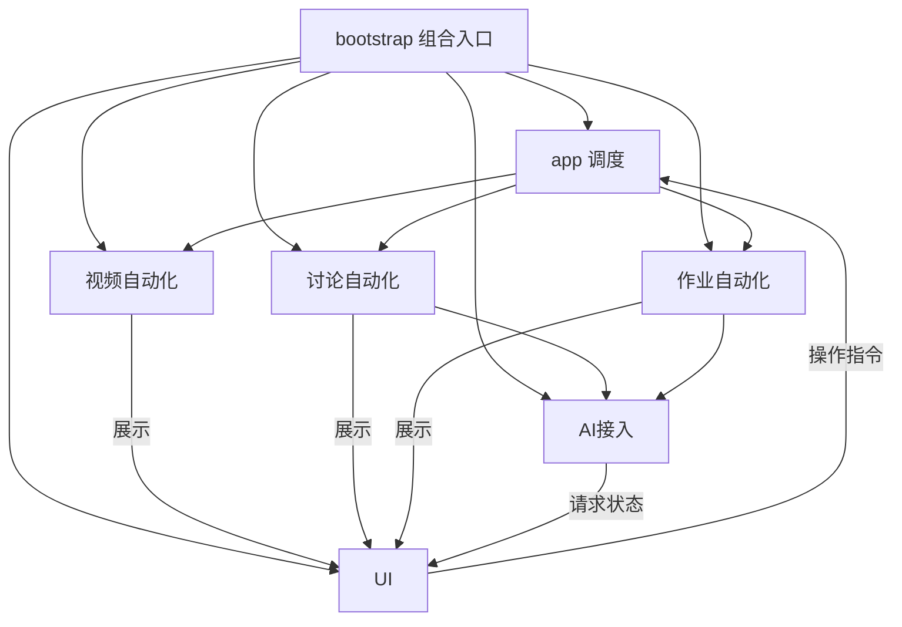

# 模块与对象

业务分为五个对象，使用闭包管理私有状态，通过明确的端口协作。`app`负责调度，`shared`提供底层工具；最终仍生成一个油猴安装文件。

| 业务对象 | 源码 | 状态与职责 |
| --- | --- | --- |
| UI | `src/ui/controller.cjs`、`panel.cjs` | 面板、样式、拖动、视图、进度展示、事件转发 |
| 视频自动化 | `src/video/controller.cjs` | 播放器实例、倍速、静音、控件标记、暂停恢复、完成度与补播 |
| 讨论自动化 | `src/discussion/controller.cjs` | 评论抽样、草稿、发布记录、结果确认和下一讨论 |
| 作业自动化 | `src/assignment/controller.cjs` | 图文、知识导引、讲稿、参考库、题目、填写、判分和跳题 |
| AI接入 | `src/ai/client.cjs`、`protocol.cjs` | 连接设置、请求句柄、统计、取消、健康检测、消息及结果协议 |

本机服务继续从`tools/model-service.cjs`启动，传输与文件解析工具保留原位置。`src/course-core.cjs`保留旧导入路径，转发到共用的数据工具；服务启动命令与`.local/model-service.json`路径均保留。

## 组合关系



三个自动化对象不调用彼此的业务方法。共用的DOM赋值放在`shared/dom.cjs`，因此讨论填写无需依赖作业对象。页面选择器、目录识别、导航、可见性和验证检测集中在`shared/platform.cjs`。

`app`统一持有模式、启停状态、当前任务、标签页租约、阶段和提交策略。提交开关仍按课程及作业/讨论模式保存。任务对象通过传入的运行上下文和`runCurrent`检查，保留路由切换、验证、暂停及旧响应取消的原有规则。

## 一键流程与作业子任务

一键流程由`app`调度：`video → discussion → materials → assignments → done`，界面合并显示为三个主要任务，最后一个任务包含收集材料、完成作业。计划保存在`course-workflow:<课程ID>`，含当前阶段、暂停状态、视频结果和待确认导航；人工切换独立模式/子任务取消计划。空目录继续等待，实际目录中没有对应类型才推进；已点击目录等待确认，15秒超时暂停。

1.13.0在计划中保存用于展示的`coverage`，执行仍重新检查目录和缓存。阶段切换不清空既有处理记录；新一轮保留确认的视频和已完成项，重查上轮跳过/缺失项。作业对象提供`assignmentCompleted`核对完整题号、题数、所选题型和确认结果，平台对象提供目录完成标记；调度器保留本轮处理时间，避免把重试失败当作完成或在本轮循环。UI分为任务、材料、设置、诊断，材料编辑状态继续通过作业对象控制异步取消与填写保护，不改变参考库存储键。

1.14.0的目录快照只在一次同步轮询内复用，轮询结束、目录点击或路由变化时失效，验证码和题目状态仍实时检查。作业当前题在同一轮同步逻辑中只读取一次，异步请求后继续重新核对题目；一键统计按章节复用材料读取，并按作业ID建立题目索引。材料编辑界面关闭时不重建参考库视图。

视频对象通过`app.videoFinished`报告既有完成/补播判定，调度器调用作业对象的`captureVideoMaterial`缓存当前文字并选择下一阶段。视频对象不依赖作业对象，作业对象也不控制播放；材料仍由作业模块管理，调度器承担跨任务编排。采集只操作已有讲稿标签，不新增网络读取或模型调用；正文稳定2秒或20秒超时后结束等待，保留缺失状态。后续`reuseMaterialCoverage`复用有效缓存，避免重复访问已采集的视频。

`course-assignment-action:<课程ID>`保存收集材料/完成作业选择；`course-question-types:<课程ID>`保存五种题型的选择。筛选发生在判分与异步作答前，未选题型只写入跳过记录，不生成提交记录。更新筛选取消旧任务并清空本轮作业遍历标记，所选题型纳入跳过版本签名，保留缓存、人工答案和已提交结果。验证码、页面编辑和弹窗仍先于自动操作。

## 文件结构

```text
src/
  app.cjs                 模式、生命周期和流程调度
  bootstrap.cjs           构造及连接对象
  version.cjs             唯一版本号
  userscript-header.txt   油猴元数据模板
  ui/
    controller.cjs        展示与交互
    panel.cjs             HTML、样式和挂载
  video/controller.cjs
  discussion/controller.cjs
  assignment/controller.cjs
  ai/
    client.cjs            浏览器到本机服务的客户端
    protocol.cjs          与本机服务共用的消息和结果协议
  shared/
    platform.cjs          页面与目录适配
    dom.cjs               通用表单赋值
    course-core.cjs       缓存、题目数据、匹配与答案校验
  course-core.cjs         原导入路径兼容入口
tools/
  build.cjs               仅从源码生成安装脚本
  module-contracts.cjs    模块依赖与公开接口检查
yuketang-autoplay.user.js 生成的安装文件
```

## 接口边界

- UI负责呈现和发送命令；导入、修改答案、保存连接口令、切换模式等操作由相应对象执行。
- 视频对象管理播放器状态；调度器通过`tick`、`suspend`、`release`等方法协作。
- AI对象管理请求取消句柄。其他对象调用`cancelTask`、`clearTaskStatus`、`recordValidation`等方法，不直接修改句柄。
- 页面适配器提供`catalogSnapshot`、`clickNavigation`、`humanVerification`等方法。业务对象保留现有选择器和判断规则。
- 显示缓存由UI拥有，其他对象通过失效方法请求刷新。
- 模块不向`window`注册业务对象。测试私有接口仅在Node构造时可用，构建时会移除。

构建器检查每个`ports.对象.成员`是否存在，并限制自动化对象间的直接依赖。新增接口需要在所属对象公开；越界调用或拼错接口会使构建失败。

## 初始化与构建

1. 构造底层适配器、调度器和五个业务对象。
2. 对象全部就绪后，连接UI事件。
3. 由调度器启动原有检查循环。

UI连接和调度器启动具有重复调用保护，避免重复注册事件、菜单或创建多个轮询。

```powershell
node .\tools\build.cjs
node --check .\yuketang-autoplay.user.js
node --test
```

可在其他工作目录生成独立文件：

```powershell
node .\tools\build.cjs --out .\yuketang-built.user.js
```

安装文件完全由源码生成，构建不读取旧安装文件作为模板，不依赖网络加载模块或新增第三方构建依赖。后续修改对应源码后重新构建，覆盖油猴原脚本即可。

## 行为验证

原有287项测试保留，细粒度流程测试通过测试适配层构造新对象；断言继续覆盖播放、目录、作业、讨论、缓存、模型、本机服务与文件解析。新增10项架构测试覆盖可重复构建、独立输出、接口检查、业务隔离、私有状态隔离和重复启动保护。

这次重构未改变课程DOM规则、判分与提交条件、轮询间隔、存储键、站点匹配和本机API地址，也未加入此前撤回的AI学伴目录假设。没有向真实课程提交内容，浏览器现场联调未包含在本轮验证中。
